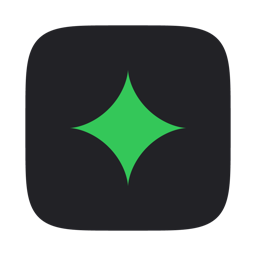
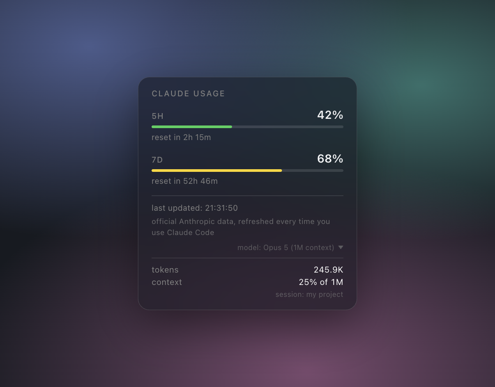
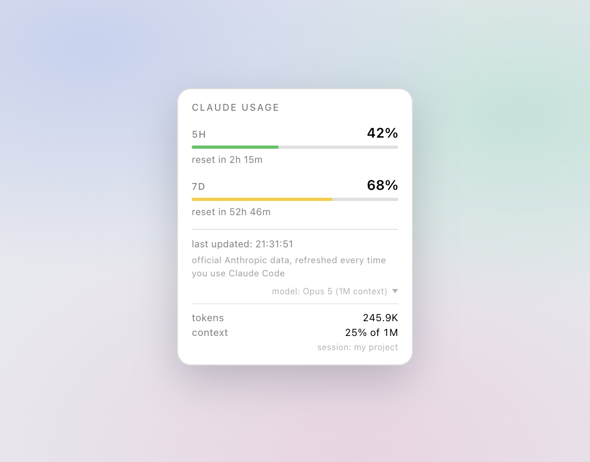
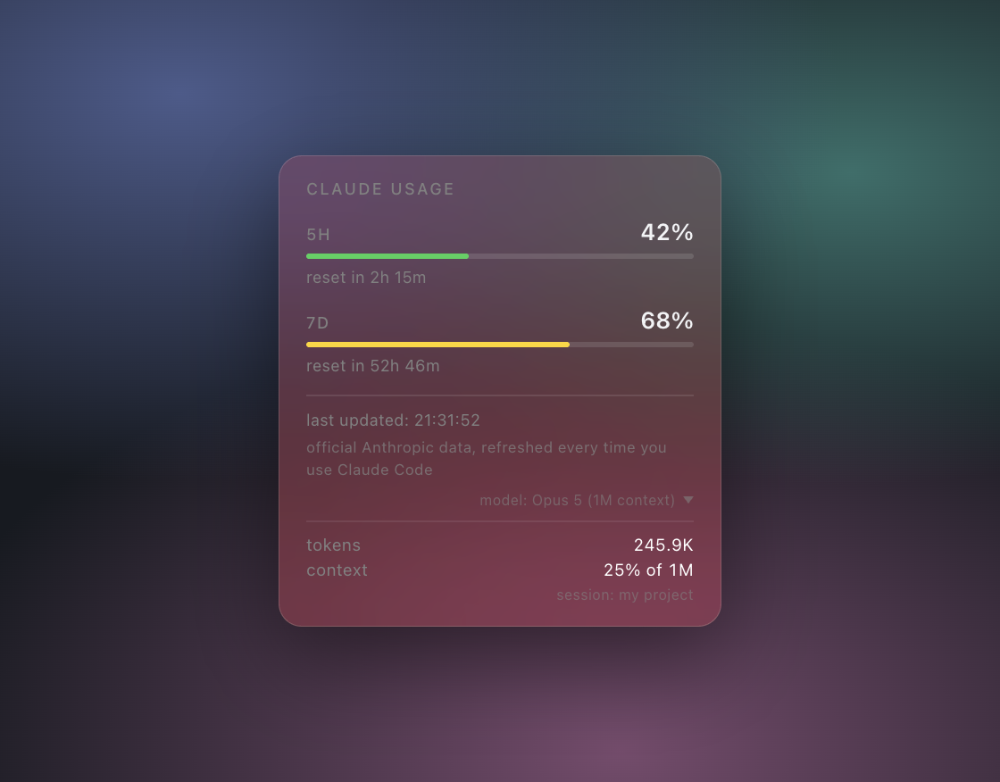

<p align="center">
  
</p>

<h1 align="center">Claude Usage</h1>

<p align="center">
  <b>Know how much Claude Code quota you have left — before you hit the wall.</b><br>
  A menu bar app for macOS — and system tray app for Windows — that keeps Anthropic's official usage figure in front of you, all the time.
</p>

<p align="center">
  <a href="https://github.com/malenitaa/usage/releases/latest"></a>
  <a href="./LICENSE"></a>
  
  <a href="./SECURITY.md"></a>
</p>

<p align="center">
  
</p>

---

## Why

Claude Code Pro and Max accounts run two usage limits at once: a **5-hour**
window and a **7-day** one. Most people find out where they stand by hitting the
limit in the middle of something.

This puts the number in your menu bar instead. It is Anthropic's own figure,
taken from what Claude Code itself reports — not an estimate rebuilt from token
counts.

## What you get

**A ring gauge** in the menu bar that fills as you use your quota, coloured in
your Mac's own system colours:

- green — plenty left (0-50%)
- yellow — halfway there (50-80%)
- red — running out (80-100%)

The arc shows *how much*, the colour shows *how urgent* — one glance, two
answers.

**A popover**, one click away: the exact percentage for each window, a countdown
to the reset, and when the figure was last refreshed.

**Your current session**, behind a small disclosure — how many tokens it has
used, and how much of the context window is gone. Everything above it is per
account; this part is per session, so it carries the session name.

**It looks like macOS**, because it borrows from macOS: the panel is the same
translucent material Control Center uses, it follows your light/dark appearance,
and the traffic-light colours are the system's own greens, yellows and reds.

**It speaks your language.** English and Spanish, chosen automatically from your
Mac's system language, with any other language falling back to English.

## Install

Go to **[INSTALL.md](INSTALL.md)** — written for anyone, no programming needed.

You will need macOS or Windows, and [Claude Code](https://claude.com/claude-code)
with a Pro or Max claude.ai account. macOS also needs `jq`; Windows needs
nothing extra — its script is PowerShell, which ships with the system.

Leaving is documented as thoroughly as arriving: the same guide lists the
app's [complete footprint and how to remove it](INSTALL.md#uninstall) — every
file it ever writes, on both platforms.

## How it works

Two small pieces, deliberately kept apart:

1. **A statusline script** — bash on macOS, PowerShell on Windows, same logic.
   Claude Code runs it on its own every few seconds while you work. It writes
   the quota figures to one small local file,
   `~/.claude/quota-status/current.json`.
2. **The menu bar app.** It reads that file every ~18 seconds and draws the icon
   and the popover. That is all it does.

Only the script ever sees the real data, and the only file it can write is its
own. The app only reads. Never open the app and the data is still recorded;
never run the script and the app says so rather than inventing a number.

## Settings

One file, `~/.claude/usage-app-config.json`, one JSON object:

```json
{
  "trayDisplay": ["bar", "5h", "7d"],
  "panelStyle": "glass",
  "statuslineDisplay": "numbers",
  "staleMinutes": 10
}
```

Every key is optional. Anything missing, misspelled or invalid falls back to its
default instead of breaking.

### `trayDisplay` — what sits in the menu bar

Three independent pieces: the colour-coded icon (`bar`), the 5-hour percentage
(`5h`), the 7-day percentage (`7d`). Any combination works.

| You want to see                        | `trayDisplay`         |
| -------------------------------------- | --------------------- |
| Everything                             | `["bar", "5h", "7d"]` |
| Just the colour-coded icon *(default)* | `["bar"]`             |
| Just the two percentages               | `["5h", "7d"]`        |
| Only the 5-hour percentage             | `["5h"]`              |
| Only the 7-day percentage              | `["7d"]`              |
| Nothing (a plain dot, still clickable) | `[]`                  |

Order does not matter. Takes effect on the next refresh (~18s), no restart.
The `5h`/`7d` text lives next to the icon on macOS only — Windows tray icons
have no text slot, so there the tooltip carries the numbers and the ring's arc
already shows the level.

### `panelStyle` — pick your material

The popover has two personalities, and both are first-class:

| `"glass"` *(default)* | `"solid"` |
| :---: | :---: |
|  |  |
| The same frosted material Control Center uses. It picks up whatever is behind it and just *belongs* in the menu bar. | An honest, opaque panel in the system colours. Unbeatable over a busy wallpaper, and the calmer choice if translucency distracts you. |

Both follow your system's light/dark appearance on their own. On Windows the
glass is acrylic (Windows 11; on Windows 10 it gracefully lands as a plain dark
or light panel). Switching styles takes an app restart — the two are genuinely
different kinds of window, not a CSS trick.

### `panelTint` — make it yours

Any `"#RRGGBB"` colour washes the panel — glass or solid — while everything
else stays legible:

<p align="center">
  
</p>

```json
{ "panelStyle": "glass", "panelTint": "#E0473C" }
```

The wash strength is fixed on purpose. The bars speak in colour — green, yellow,
red is the whole point — so your tint gets the background, never the microphone.
Anything that isn't a valid `#RRGGBB` is ignored. Applies the next time the
popover opens; no restart needed.

### `statuslineDisplay` — the line in your terminal

- `"numbers"` *(default)* — `Claude usage - 5h: 44%  7d: 38%`
- `"bar"` — `Claude usage - 5h [####......]  7d [####......]`, drawn with
  Unicode block glyphs. If your terminal font shows boxes or `?`, use
  `"numbers"`.
- `"none"` — prints nothing when the read succeeds. Errors are always shown,
  because those mean something needs fixing.

Takes effect the next time Claude Code refreshes the statusline.

### `staleMinutes` — when a closed session should leave the panel

The panel shows what is *running*. The statusline only reports while a
Claude Code session is alive, so once an account's last session closes, its
reading stops refreshing — and after this many minutes (default `10`) the
panel lets it go instead of showing a frozen number. With nothing running at
all, the panel says so and the tray goes neutral.

- Raise it if an idle-but-open terminal of yours disappears from the panel —
  idle sessions report irregularly.
- `0` — never hide: always show each account's last known reading, stamped
  with the time it was taken.

## More than one account

If you run Claude Code under several accounts on one machine (say, via
`CLAUDE_CONFIG_DIR` aliases), each account gets its own name and pair of
bars in the panel, attributed by the login of the config dir each session
inherits — concurrent sessions of different accounts don't mix. The ring in
the menu bar shows the worst number across whatever is live. One account
looks exactly like the app always did, name included.

### How to run more than one account in the terminal

Claude Code keeps its login in a config dir — `~/.claude.json` and friends —
and the `CLAUDE_CONFIG_DIR` environment variable points it at a different
one. Give each extra account its own dir behind an alias:

**macOS / Linux** — add to `~/.zshrc` (or `~/.bashrc`):

```bash
alias claude-work='CLAUDE_CONFIG_DIR="$HOME/.claude-work" claude'
```

**Windows** — add to your PowerShell profile (`notepad $PROFILE`):

```powershell
function claude-work { $env:CLAUDE_CONFIG_DIR = "$HOME\.claude-work"; & claude @args }
```

Open a new terminal, run `claude-work`, and `/login` with that account —
once. The dir is created for you and the login sticks to it. From then on,
plain `claude` is one account and `claude-work` is another, running side by
side without stepping on each other, and this panel shows each under its own
name. Add as many aliases as you have accounts.

One warning from lived experience: the **default** config dir (plain
`claude`) is shared with the Claude desktop app. Logging into the desktop
app replaces that login — including for terminals you already have open,
whose work then quietly bills the new account. Accounts you care about
keeping separate belong behind an alias, where nothing else can touch them.

## Privacy and security

- **No network.** Neither piece ever makes an internet call.
- **No credentials.** It never touches your API key or your session token.
  To tell accounts apart, the statusline script reads exactly one field from
  your local Claude Code config — the logged-in email — and it never leaves
  your machine.
- **No telemetry.** No account, no login, no tracking, nothing phoned home.
- **One local file**, readable only by you, that you can open and inspect
  whenever you like.

The threat model and how the code handles untrusted input are in
**[SECURITY.md](SECURITY.md)**.

## About the numbers

The percentage can differ slightly from claude.ai for a while. Two honest
reasons:

- The figure arrives through Claude Code sessions as they refresh, not live.
- Several sessions share one file, so the app keeps the **highest** reading
  reported for a window. Usage inside a window only ever goes up, so a lower
  reading is always an older snapshot from some other session.

The raw figure can also go past 100%: the limit is checked when a request
starts, not when it finishes, so one admitted just under the cap runs to
completion and its full cost lands on the window afterwards. Anthropic's own
usage screen caps what it shows at 100%, and so does this.

## Development

```bash
cd app
npm install
npm run dev     # run the app
npm run build   # package the .dmg into app/dist/
```

Built with Electron. `npm run build` packages the macOS `.dmg`,
`npm run build:win` the Windows installer — both icons (`.icns`/`.ico`) are
generated from the same geometry module by `npm run icon`. Platform differences
are detailed in [SECURITY.md](SECURITY.md#platform).

## Enjoyed it?

If this was useful and you would like to support the project:

- [Cafecito](https://cafecito.app/rezamalena)
- [Ko-fi](https://ko-fi.com/malenitaa)

## License

[MIT](LICENSE)
